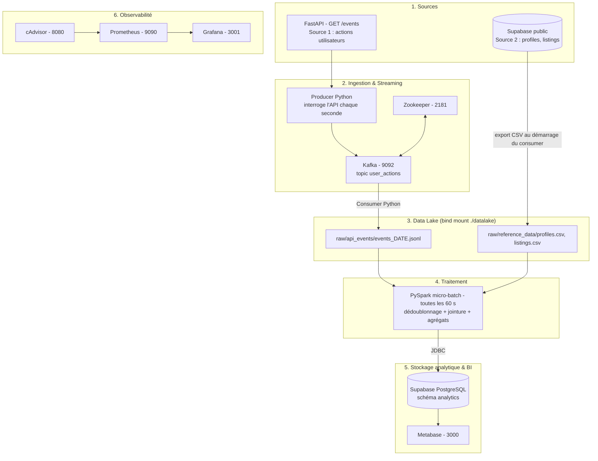

# SOKO COMMERCE — Plateforme Data Complète (TP1 + TP2 + TP3)

> **Projet réalisé dans le cadre du module Data Engineering — Nowledgeable**  
> Pipeline de données temps réel, observable, audité et nettoyé pour la marketplace SOKO COMMERCE.

---

## 📋 Table des Matières
1. [Présentation Globale & Objectifs](#1-présentation-globale--objectifs)
2. [Architecture Technique & Schéma Global](#2-architecture-technique--schéma-global)
3. [Détail des 10 Services Docker](#3-détail-des-10-services-docker)
4. [Communication Inter-couches & Flux de Données](#4-communication-inter-couches--flux-de-données)
5. [Guide de Démarrage & Déploiement](#5-guide-de-démarrage--déploiement)
6. [Audit & Nettoyage de Qualité des Données (TP3)](#6-audit--nettoyage-de-qualité-des-données-tp3)
7. [Problèmes Rencontrés & Solutions Techniques](#7-problèmes-rencontrés--solutions-techniques)
8. [Matrice de Conformité aux 3 TPs](#8-matrice-de-conformité-aux-3-tps)

---

## 1. Présentation Globale & Objectifs

La plateforme **SOKO COMMERCE** (marketplace C2C / B2C) combine ingestion temps réel, stockage hybride (Data Lake local + Data Warehouse Supabase/PostgreSQL), observabilité et audit qualité.

Le projet couvre les 3 travaux pratiques :
- **TP1 — Cartographie & Modélisation** : cartographie des sources et modélisation du schéma PostgreSQL SOKO (`profiles`, `categories`, `listings`, `listing_images`, `offers`, `deals`, `reviews`).
- **TP2 — Pipeline Temps Réel & Observabilité** : API FastAPI → Producer → Kafka → Consumer → Data Lake → PySpark (micro-batch) → PostgreSQL `analytics` → Metabase, supervisé par Prometheus / cAdvisor / Grafana.
- **TP3 — Audit & Nettoyage Qualité** : matrice de contrôle (complétude, unicité, validité, cohérence, intégrité), scripts SQL d'audit et de nettoyage exécutés en transaction de test (`BEGIN … ROLLBACK`).

---

## 2. Architecture Technique & Schéma Global



---

## 3. Détail des 10 Services Docker

`docker-compose.yml` orchestre 10 conteneurs sur le réseau interne `soko_network` :

| Service Docker | Image / Techno | Rôle & Responsabilité | Port Externe |
| :--- | :--- | :--- | :--- |
| `zookeeper` | `bitnamilegacy/zookeeper:3.8` | Coordination du broker Kafka. | `2181` |
| `kafka` | `bitnamilegacy/kafka:3.4` | Bus de messages (topic `user_actions`). | `9092`, `29092` |
| `api` | Python 3.9 / FastAPI (`./api`) | Source 1 : génère des actions utilisateurs (`GET /events`, `GET /health`) à partir des vrais IDs `profiles` / `listings`. | `8000` |
| `producer` | Python 3.9 / kafka-python (`./api`) | Interroge l'API chaque seconde et publie les événements dans Kafka. | - |
| `consumer` | Python 3.9 / kafka-python (`./kafka`) | Exporte la Source 2 (profiles, listings) en CSV puis écrit les événements Kafka dans `datalake/raw/api_events/`. | - |
| `spark_job` | Python 3.9 + PySpark + JRE (`./spark`) | Micro-batch 60 s : lecture Data Lake, nettoyage, jointure, agrégats → `analytics`. | - |
| `metabase` | `metabase/metabase:latest` | Dashboards métier connectés à Supabase. | `3000` |
| `prometheus` | `prom/prometheus:v2.45.0` | Collecte des métriques (scrape 15 s : Prometheus, cAdvisor). | `9090` |
| `grafana` | `grafana/grafana:latest` | Dashboards de supervision (datasource `http://prometheus:9090`). | `3001` |
| `cadvisor` | `gcr.io/cadvisor/cadvisor:v0.49.1` | Métriques CPU / mémoire des conteneurs. | `8080` |

---

## 4. Communication Inter-couches & Flux de Données

1. **Collecte (Source 1 — API)** :
   - Au démarrage, l'API charge les IDs `profiles` et `listings` depuis Supabase.
   - `GET /events` renvoie 1 à 5 événements : `event_id`, `timestamp`, `user_id`, `listing_id`, `action_type` (`view_listing`, `like_listing`, `send_message`, `create_offer`), `device`.
   - Le `producer` appelle l'API chaque seconde et publie chaque événement dans le topic `user_actions`.

2. **Collecte (Source 2 — référentiel)** :
   - Au démarrage, le `consumer` exporte `profiles` (id, display_name, is_seller) et `listings` (id, seller_id, category_id, title, price, status) en CSV dans `datalake/raw/reference_data/`.

3. **Data Lake** :
   - Le `consumer` lit `user_actions` et ajoute chaque événement (JSON Lines) dans `datalake/raw/api_events/events_<date>.jsonl`.

4. **Traitement & chargement (PySpark)** :
   - Toutes les 60 s : lecture des JSONL + CSV, dédoublonnage sur `event_id`, jointure événements × listings.
   - Écriture JDBC (mode `overwrite`) dans Supabase :
     - `analytics.listing_metrics` : vues, likes, offres, messages par annonce ;
     - `analytics.daily_activity` : nombre d'actions par jour et par type.

5. **Restitution & supervision** :
   - Metabase interroge le schéma `analytics` (top annonces, répartition des actions).
   - Prometheus scrape cAdvisor ; Grafana affiche CPU / mémoire à partir de Prometheus.

---

## 5. Guide de Démarrage & Déploiement

### Pré-requis
- Docker Desktop (WSL2 sous Windows).
- Un projet Supabase contenant le schéma TP1 (`postgres/init/01-schema.sql`, `02-data.sql`).

### Étapes de lancement

1. **Configuration de l'environnement** :  
   Renseigner les identifiants Supabase (pooler en mode session) :
   ```env
   DB_HOST=aws-1-eu-west-1.pooler.supabase.com
   DB_PORT=5432
   DB_NAME=postgres
   DB_USER=postgres.<project_ref>
   DB_PASSWORD=<mot_de_passe>
   ```

2. **Démarrage de la stack Docker** :
   ```bash
   docker compose up -d
   ```

3. **Vérification du statut des services** :
   ```bash
   docker ps --format "table {{.Names}}\t{{.Status}}\t{{.Ports}}"
   ```

4. **Accès aux interfaces** :
   - **API Swagger** : `http://localhost:8000/docs`
   - **Metabase BI** : `http://localhost:3000`
   - **Grafana** : `http://localhost:3001` (User: `admin` / Pass: `admin`)
   - **Prometheus UI** : `http://localhost:9090`
   - **cAdvisor** : `http://localhost:8080`

---

## 6. Audit & Nettoyage de Qualité des Données (TP3)

Le dossier `audit_qualite/` regroupe les livrables du TP3, appliqués aux tables du schéma TP1 (`profiles`, `listings`, `deals`, `reviews`) :

- **`01_matrice_qualite.md`** : cartographie mise à jour + matrice de 9 contrôles sur 5 dimensions (Complétude, Unicité, Validité, Cohérence, Intégrité).
- **`02_audit.sql`** : 7 requêtes de détection des anomalies.
- **`03_nettoyage.sql`** : corrections (substitution, valeur absolue, suppression, plafonnement).
- **`04_documentation_resultats.md`** : justification des corrections et méthode de contrôle avant / après.

### Contrôles & correctifs

| Table | Contrôle | Dimension | Action corrective |
| :--- | :--- | :--- | :--- |
| `profiles` | `display_name` NULL ou vide | Complétude | Substitution par « Utilisateur Anonyme » |
| `listings` | `price < 0` | Validité | `ABS(price)` |
| `listings` | `seller_id` sans profil correspondant | Intégrité | Suppression de l'annonce orpheline |
| `listings` | `status` hors (`active`, `reserved`, `sold`, `archived`) | Cohérence | Remplacement par `active` |
| `listings` | Doublons (même vendeur, titre, prix) | Unicité | `ROW_NUMBER()` : conservation de la plus récente |
| `deals` | `agreed_price < 0` | Validité | `ABS(agreed_price)` |
| `reviews` | `rating` hors [1 ; 5] | Validité | Plafonnement à 1 ou 5 |

Les corrections sont exécutées dans une transaction de test (`BEGIN; … ROLLBACK;`) puis l'audit est relancé pour comparer avant / après sans altérer la base.

---

## 7. Problèmes Rencontrés & Solutions Techniques

1. **Grafana ne joignait pas Prometheus** :
   - *Symptôme* : `dial tcp [::1]:9090: connect: connection refused`.
   - *Solution* : dans un conteneur, `localhost` désigne le conteneur lui-même → datasource `http://prometheus:9090` (nom du service Docker).

2. **Filtre `name!=""` dans cAdvisor sous Docker Desktop Windows** :
   - *Symptôme* : « No data » sur les requêtes par conteneur.
   - *Solution* : sous Docker Desktop, cAdvisor n'expose que les cgroups (`/`, `/docker`…) sans label `name` → requêtes sans ce filtre.

3. **Connexion à Supabase** :
   - *Symptôme* : échecs d'authentification et de connexion depuis Metabase et les conteneurs.
   - *Solution* : utilisation du pooler Supabase en mode session (`aws-1-eu-west-1.pooler.supabase.com:5432`, user `postgres.<project_ref>`) et DNS publics pour Metabase.

4. **Préservation des données lors du nettoyage (TP3)** :
   - *Symptôme* : les corrections `UPDATE` / `DELETE` modifient la base.
   - *Solution* : Data Lake brut jamais modifié ; scripts de nettoyage testés en transaction `BEGIN … ROLLBACK`.

---

## 8. Matrice de Conformité aux 3 TPs

| TP | Exigence du Sujet | Couverture dans le Projet | Statut |
| :--- | :--- | :--- | :--- |
| **TP1** | Cartographie des sources et schéma cible | Dictionnaire de données, MCD/MLD et schéma PostgreSQL (`profiles`, `categories`, `listings`, `listing_images`, `offers`, `deals`, `reviews`). | ✅ Réalisé |
| **TP2** | Ingestion streaming, stockage, observabilité | 10 conteneurs : API, Kafka, Data Lake, PySpark, Supabase, Metabase, Prometheus, Grafana, cAdvisor. | 🟡 Pipeline fonctionnel — reste : métriques PostgreSQL et indicateur Raw vs Clean dans Grafana |
| **TP3** | Audit qualité, matrice, SQL & rapport | Matrice (01), audit SQL (02), nettoyage (03), documentation (04). | 🟡 Livrables rédigés — reste : chiffres mesurés avant / après |

---

*Dernière mise à jour : Septembre 2026*
