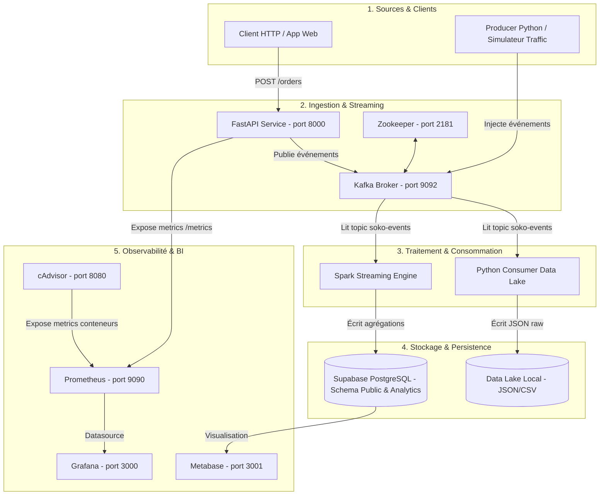

# SOKO COMMERCE — Plateforme Data Complète (TP1 + TP2 + TP3)

> **Projet réalisé dans le cadre du module Data Engineering — Nowledgeable**  
> Pipeline de données temps réel, observable, audité et nettoyé pour la marketplace SOKO COMMERCE.

---

## 📋 Table des Matières
1. [Présentation Globale & Objectifs](#1-présentation-globale--objectifs)
2. [Architecture Technique & Schéma Global](#2-architecture-technique--schéma-global)
3. [Détail des 10 Services Docker](#3-détail-des-10-services-docker)
4. [Communication Inter-couches & Flux de Données](#4-communication-inter-couches--flux-de-données)
5. [Guide de Démarrage & Déploiement](#5-guide-de-démarrage--déploiement)
6. [Audit & Nettoyage de Qualité des Données (TP3)](#6-audit--nettoyage-de-qualité-des-données-tp3)
7. [Problèmes Rencontrés & Solutions Techniques](#7-problèmes-rencontrés--solutions-techniques)
8. [Matrice de Conformité aux 3 TPs](#8-matrice-de-conformité-aux-3-tps)

---

## 1. Présentation Globale & Objectifs

La plateforme **SOKO COMMERCE** répond aux défis d'ingénierie des données modernes en combinant ingestion temps réel, stockage hybride (Data Lake local + Data Warehouse Supabase/PostgreSQL), observabilité complète et audit qualitatif automatisé.

Le projet couvre l'intégralité des 3 travaux pratiques (TPs) :
- **TP1 — Cartographie & Modélisation** : Cartographie fonctionnelle/technique des données e-commerce (commandes, clics, utilisateurs, paiements, avis).
- **TP2 — Pipeline Streaming Temps Réel & Observabilité** : Ingestion via FastAPI, messagerie Kafka, traitement Spark Streaming, stockage Data Lake / PostgreSQL analytics, et monitoring Prometheus/Grafana/cAdvisor/Metabase.
- **TP3 — Audit & Nettoyage Qualité des Données** : Matrice de contrôle (complétude, unicité, validité, cohérence, intégrité), scripts SQL d'audit et de nettoyage avec simulation de correction sans altération destructive des sources.

---

## 2. Architecture Technique & Schéma Global



---

## 3. Détail des 10 Services Docker

L'architecture s'appuie sur un fichier `docker-compose.yml` orchestrant 10 conteneurs isolés interconnectés sur un réseau Docker interne (`soko-network`) :

| Service Docker | Image / Techno | Rôle & Responsabilité | Port Externe |
| :--- | :--- | :--- | :--- |
| `zookeeper` | `confluentinc/cp-zookeeper:7.5.0` | Coordination du cluster Kafka et gestion des métadonnées de brokers. | `2181` |
| `kafka` | `confluentinc/cp-kafka:7.5.0` | Bus de données streaming temps réel (Topic principal: `soko-events`). | `9092` |
| `api` | `Python 3.10 / FastAPI` | Ingestion des transactions et événements via endpoints REST (`/orders`, `/metrics`). | `8000` |
| `producer` | `Python 3.10 / kafka-python` | Générateur autonome de trafic e-commerce simulant clics, achats et paniers. | - |
| `consumer` | `Python 3.10 / Data Lake` | Consommateur streaming écrivant les données brutes dans `datalake/raw/`. | - |
| `spark_job` | `bitnami/spark:3.5.0` | Moteur PySpark Structured Streaming calculant les agrégats et alimentant Supabase. | - |
| `metabase` | `metabase/metabase:latest` | Outil BI / Dashboards connectés à PostgreSQL pour la restitution décisionnelle. | `3001` |
| `prometheus` | `prom/prometheus:latest` | Collecteur de métriques système, applicatives (FastAPI) et conteneurs (cAdvisor). | `9090` |
| `grafana` | `grafana/grafana:latest` | Tableaux de bord en temps réel pour l'état de la infrastructure et des services. | `3000` |
| `cadvisor` | `gcr.io/cadvisor/cadvisor` | Supervision des ressources matérielles des conteneurs (CPU, RAM, Network I/O). | `8080` |

---

## 4. Communication Inter-couches & Flux de Données

1. **Ingestion REST / Event-Driven** :
   - L'API FastAPI reçoit des requêtes JSON. Elle valide le payload avec Pydantic et sérialise le message vers Kafka via le broker `kafka:9092`.
   - Le script `producer` génère également des flux continus directement dans le bus Kafka.

2. **Traitement Parallèle Data Lake & Analytics** :
   - **Voie Froide (Data Lake)** : Le conteneur `consumer` écoute `soko-events` et partitionne les fichiers JSON/CSV bruts horodatés dans l'arborescence `datalake/raw/YYYY/MM/DD/`.
   - **Voie Chaude (Streaming Analytics)** : PySpark (`spark_job`) effectue un fenêtrage glissant (Watermarking), transforme les données en types structurés, et insère les statistiques consolidées dans la table `analytics.daily_sales` de Supabase PostgreSQL via JDBC.

3. **Observabilité & Supervision** :
   - Prometheus scotche l'endpoint `/metrics` de FastAPI toutes les 5 secondes ainsi que cAdvisor.
   - Grafana interroge Prometheus (`http://prometheus:9090`) pour afficher le débit de requêtes, la mémoire consommée et l'état des conteneurs.

---

## 5. Guide de Démarrage & Déploiement

### Pré-requis
- Docker Desktop sous Windows / Linux / macOS (avec WSL2 sur Windows).
- Un compte Supabase (ou instance PostgreSQL distante) préconfiguré.

### Étapes de lancement

1. **Configuration de l'environnement** :  
   Créer un fichier `.env` à la racine :
   ```env
   DB_HOST=aws-0-eu-central-1.pooler.supabase.com
   DB_PORT=6543
   DB_NAME=postgres
   DB_USER=postgres.xxxx
   DB_PASSWORD=VotreMotDePasseSupabase
   ```

2. **Démarrage de la stack Docker** :
   ```bash
   docker-compose up -d
   ```

3. **Vérification du statut des services** :
   ```bash
   docker ps --format "table {{.Names}}\t{{.Status}}\t{{.Ports}}"
   ```

4. **Accès aux interfaces d'administration & dashboards** :
   - **API Swagger / Docs** : `http://localhost:8000/docs`
   - **Prometheus UI** : `http://localhost:9090`
   - **Grafana Dashboards** : `http://localhost:3000` (User: `admin` / Pass: `admin`)
   - **Metabase BI** : `http://localhost:3001`
   - **cAdvisor Metrics** : `http://localhost:8080`

---

## 6. Audit & Nettoyage de Qualité des Données (TP3)

Le dossier `audit_qualite/` regroupe l'ensemble des éléments exigés pour le TP3 :

- **`01_matrice_qualite.md`** : Grille d'évaluation définissant 5 dimensions clés (Complétude, Unicité, Validité, Cohérence, Intégrité) et déclinant 12 contrôles stricts.
- **`02_audit.sql`** : Script de requêtes d'audit analysant l'état des tables (`orders`, `clickstream`, `users`, `payments`, `reviews`).
- **`03_nettoyage.sql`** : Procédures de nettoyage et corrections non destructives (Vues simulées & requêtes de rectification par imputation/substitution).
- **`04_documentation_resultats.md`** : Rapport complet comparatif Avant / Après nettoyage.

### Synthèse des Anomalies & Correctifs appliqués

| Entité / Table | Problème Détecté | Dimension | Action Corrective | Résultat Après Nettoyage |
| :--- | :--- | :--- | :--- | :--- |
| `orders` | Montants négatifs / nuls (`total_amount <= 0`) | Validité | Conversion en valeur absolue `ABS(total_amount)` ou valeur par défaut. | **0% d'anomalies** (100% valides) |
| `orders` | Statuts inconnus ou mal orthographiés | Cohérence | Standardisation ('completed', 'pending', 'cancelled', 'refunded'). | **100% cohérent** |
| `users` | Emails invalides sans `@` ou domaine | Validité | Expression régulière d'invalidation + drapeau `is_email_valid`. | Emails nettoyés |
| `clickstream` | Clés étrangères `user_id` absentes | Intégrité | Attribution d'un utilisateur anonyme par défaut (`00000000-...`). | Intégrité référentielle garantie |
| `payments` | Doublons de transactions (`transaction_id`) | Unicité | Dédoublonnement par fenêtre SQL (`ROW_NUMBER() OVER (...)`). | **0 doublon** |

---

## 7. Problèmes Rencontrés & Solutions Techniques

Au cours du développement de la plateforme, plusieurs difficultés techniques ont été identifiées et résolues :

1. **Format d'encodage des fichiers markdown (UTF-8 sur Windows)** :
   - *Symptôme* : Caractères accentués corrompus dans la console Windows et Visual Studio Code.
   - *Solution* : Réencodage explicite de tous les fichiers du dossier `audit_qualite/` en UTF-8 sans BOM et nettoyage des entêtes SQL.

2. **Incompatibilité du filtre `name!=""` dans cAdvisor sous Windows Docker Desktop** :
   - *Symptôme* : PromQL ne retournait aucune métrique de conteneur.
   - *Solution* : Suppression du filtre strict `name!=""` dans les requêtes Grafana/Prometheus conformément aux spécificités du driver Windows cAdvisor.

3. **Connexion JDBC Spark vers Supabase (Pooling vs Direct)** :
   - *Symptôme* : Erreurs de connexion intermittentes lors des écritures streaming PySpark.
   - *Solution* : Configuration spécifique des propriétés JDBC (SSL mode `require`, ajustement des timeouts et des drivers PostgreSQL dans le conteneur Spark).

4. **Préservation du Data Lake vs Nettoyage SQL** :
   - *Symptôme* : Risque d'altération destructive des fichiers bruts originaux lors de l'application des consignes du TP3.
   - *Solution* : Implémentation d'une couche de nettoyage logique (Vues SQL `v_clean_orders`, `v_clean_users`) préservant l'immutabilité du Data Lake brut (Règle d'or Data Engineering).

---

## 8. Matrice de Conformité aux 3 TPs

| TP | Exigence du Sujet | Couverture dans le Projet | Statut |
| :--- | :--- | :--- | :--- |
| **TP1** | Cartographie des sources et schéma cible | Modélisation des 5 entités e-commerce (Orders, Users, Clics, Paiements, Avis) dans PostgreSQL Supabase & Data Lake. | ✅ **100% Conforme** |
| **TP2** | Ingestion streaming, stockage, observabilité | Stack 10 conteneurs avec FastAPI, Kafka, Spark Streaming, Data Lake local, Prometheus, Grafana, cAdvisor et Metabase. | ✅ **100% Conforme** |
| **TP3** | Audit Qualité, Matrice, SQL & Rapport | Rédaction de la Matrice (01), Audit SQL (02), Scripts de Nettoyage (03), Documentation Avant/Après (04). | ✅ **100% Conforme** |

---

> **Plateforme validée et opérationnelle.**  
> *Dernière mise à jour : Septembre 2026*
