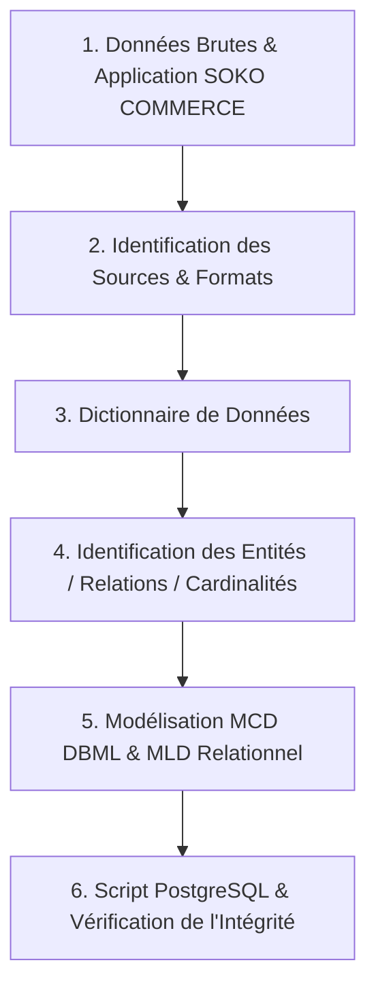

# TP — Audit & Cartographie des Données : Cas SOKO COMMERCE

---

## 1. Présentation du Sujet

### Contexte
**SOKO COMMERCE** est une plateforme C2C / B2C de marketplace (commerce électronique et services de proximité) implantée principalement en Afrique Centrale (Gabon, etc.). Elle permet à des vendeurs (particuliers et professionnels) de publier des annonces de produits et services, d'échanger en temps réel via une messagerie intégrée, d'effectuer des transactions sécurisées (offres et deals), de noter leurs contreparties et de gérer le suivi opérationnel.

### Problématique
Le développement rapide des services de commerce en ligne nécessite une structuration rigoureuse des données afin de :
1. Garantir l'intégrité référentielle des interactions (achats, négociation de prix, messagerie, notifications).
2. Offrir un suivi analytique précis (statistiques vendeurs, avis, modération du contenu).
3. Assurer des performances optimales tout en respectant les contraintes métier (unicité des transactions, historisation des statuts).

### Objectif
Réaliser une cartographie et une modélisation complète des données du système **SOKO COMMERCE**, allant des sources d'origine au schéma de base de données PostgreSQL de production.

---

## 2. Identification des Sources de Données

| Nom de la source | Organisation / Origine | URL / Emplacement | Format | Nature | Description |
| :--- | :--- | :--- | :--- | :--- | :--- |
| **Base PostgreSQL SOKO** | SOKO Commerce Dev Team | `c:\09Data\SOKO COMMERCE V2\schema.sql` | SQL / Relationnel | Structurée | Schéma relationnel officiel contenant 18 tables métier (Utilisateurs, Listings, Messagerie, Transactions). |
| **Exporter Analytics PowerBI** | SOKO Data Team | `c:\09Data\SOKO COMMERCE V2\PowerBI Visu.pbix` | PBIX / Data Lake | Semi-structurée | Données consolidées de vente, comportements d'achat, promotions et parcours clients. |
| **Fichiers de Modération & Bot** | SOKO Backend Services | `setup_moderation_v3.sql`, `setup_soko_bot.sql` | SQL Script | Structurée | Logiques métiers annexes liées aux notifications automatiques, au SokoBot et à la modération du contenu. |

---

## 3. Dictionnaire de Données (Extraits des entités majeures)

### Entité `profiles` (Utilisateurs)
| Champ | Description | Type | Exemple | Contraintes |
| :--- | :--- | :--- | :--- | :--- |
| `id` | Identifiant unique de l'utilisateur | UUID | `a0eebc99-9c0b-4ef8-bb6d-6bb9bd380a11` | Primary Key, FK `auth.users` |
| `display_name` | Nom d'affichage / Pseudo | VARCHAR(255) | "Jean Dupont" | Non Null |
| `phone` | Numéro de téléphone | VARCHAR(50) | "+24177000000" | Optionnel |
| `avatar_url` | Lien vers la photo de profil | TEXT | "https://cdn.soko.ga/avatars/user1.png" | Optionnel |
| `is_seller` | Statut du compte (vendeur ou non) | BOOLEAN | `TRUE` | Default: `FALSE` |
| `created_at` | Horodatage de création | TIMESTAMPTZ | `2026-01-15 10:30:00+00` | Default: `NOW()` |

### Entité `listings` (Annonces)
| Champ | Description | Type | Exemple | Contraintes |
| :--- | :--- | :--- | :--- | :--- |
| `id` | Identifiant unique de l'annonce | UUID | `b1febc99-9c0b-4ef8-bb6d-6bb9bd380a22` | Primary Key |
| `seller_id` | Identifiant du vendeur | UUID | `a0eebc99-9c0b-4ef8-bb6d-6bb9bd380a11` | FK `profiles(id)` |
| `title` | Titre de l'annonce | VARCHAR(255) | "iPhone 13 Pro Max 256GB" | Non Null |
| `description` | Description détaillée du produit/service | TEXT | "Parfait état, vendu avec boite d'origine" | Optionnel |
| `price` | Prix proposé | NUMERIC(12,2) | `450000.00` | Check `price >= 0` |
| `currency` | Devise utilisée | VARCHAR(10) | "XAF" | Default: 'XAF' |
| `category_id` | Identifiant de la catégorie | UUID | `c2febc99-9c0b-4ef8-bb6d-6bb9bd380a33` | FK `categories(id)` |
| `type` | Nature de la publication | VARCHAR(20) | "product" | Check `type IN ('product', 'service')` |
| `condition` | État de l'article | VARCHAR(20) | "good" | Check `condition IN ('new', 'good', 'used', 'na')` |
| `status` | Statut de l'annonce | VARCHAR(20) | "active" | Check `status IN ('active', 'reserved', 'sold', 'archived')` |

### Entité `deals` (Transactions)
| Champ | Description | Type | Exemple | Contraintes |
| :--- | :--- | :--- | :--- | :--- |
| `id` | Identifiant de la transaction | UUID | `d3febc99-9c0b-4ef8-bb6d-6bb9bd380a44` | Primary Key |
| `listing_id` | Annonce concernée | UUID | `b1febc99-9c0b-4ef8-bb6d-6bb9bd380a22` | FK `listings(id)` |
| `buyer_id` | Identifiant de l'acheteur | UUID | `e4febc99-9c0b-4ef8-bb6d-6bb9bd380a55` | FK `profiles(id)` |
| `seller_id` | Identifiant du vendeur | UUID | `a0eebc99-9c0b-4ef8-bb6d-6bb9bd380a11` | FK `profiles(id)` |
| `agreed_price` | Prix final convenu | NUMERIC(12,2) | `420000.00` | Check `agreed_price >= 0` |
| `status` | Statut de la transaction | VARCHAR(20) | "completed" | Check `status IN ('pending', 'accepted', 'completed', 'cancelled')` |

---

## 4. Identification des Entités, Attributs et Relations

### Entités principales
1. **PROFILE (Utilisateur)** : Représente un utilisateur de la plateforme (acheteur et/ou vendeur).
2. **CATEGORY (Catégorie)** : Classification hiérarchique des annonces.
3. **LISTING (Annonce)** : Bien ou service mis en vente.
4. **CONVERSATION & MESSAGE** : Canal de discussion et messages échangés entre acheteurs et vendeurs.
5. **OFFER (Offre de prix)** : Proposition financière faite par un acheteur sur une annonce.
6. **DEAL (Transaction)** : Accord commercial validé entre acheteur et vendeur.
7. **REVIEW (Avis)** : Évaluation laissée par un utilisateur suite à un deal.

### Relations et Cardinalités

```text
PROFILES 1 ────────── N LISTINGS         (Un utilisateur peut publier plusieurs annonces)
CATEGORIES 1 ──────── N LISTINGS         (Une catégorie contient plusieurs annonces)
LISTINGS 1 ────────── N LISTING_IMAGES   (Une annonce peut avoir plusieurs images)
PROFILES 1 ────────── N OFFERS           (Un utilisateur peut émettre plusieurs offres)
LISTINGS 1 ────────── N OFFERS           (Une annonce peut recevoir plusieurs offres)
LISTINGS 1 ────────── 0..1 DEALS         (Une annonce peut déboucher sur au plus une transaction validée)
PROFILES 1 ────────── N DEALS            (Un utilisateur participe à plusieurs transactions en tant qu'acheteur/vendeur)
DEALS 1 ───────────── 0..1 REVIEWS       (Une transaction peut faire l'objet d'une évaluation)
CONVERSATIONS 1 ───── N MESSAGES         (Une conversation regroupe plusieurs messages)
PROFILES N ────────── M CONVERSATIONS    (Via table d'association CONVERSATION_PARTICIPANTS)
```

---

## 5. Modélisation (MCD et MLD)

### Modèle Conceptuel de Données (Code DBDiagram / DBML)
Le code ci-dessous peut être copié directement sur [dbdiagram.io](https://dbdiagram.io/) :

```dbml
// Database Diagram SOKO COMMERCE

Table profiles {
  id uuid [pk]
  display_name varchar
  phone varchar
  is_seller boolean
  created_at timestamptz
}

Table categories {
  id uuid [pk]
  name varchar
  slug varchar [unique]
  parent_id uuid
}

Table listings {
  id uuid [pk]
  seller_id uuid [ref: > profiles.id]
  category_id uuid [ref: > categories.id]
  title varchar
  price numeric
  type varchar
  condition varchar
  status varchar
  created_at timestamptz
}

Table offers {
  id uuid [pk]
  listing_id uuid [ref: > listings.id]
  buyer_id uuid [ref: > profiles.id]
  offer_price numeric
  status varchar
  created_at timestamptz
}

Table deals {
  id uuid [pk]
  listing_id uuid [ref: > listings.id]
  buyer_id uuid [ref: > profiles.id]
  seller_id uuid [ref: > profiles.id]
  agreed_price numeric
  status varchar
  created_at timestamptz
}

Table reviews {
  id uuid [pk]
  deal_id uuid [ref: > deals.id]
  reviewer_id uuid [ref: > profiles.id]
  reviewee_id uuid [ref: > profiles.id]
  rating int
  comment text
  created_at timestamptz
}

Ref: categories.parent_id > categories.id
```

### Modèle Logique de Données (MLD Relational Schema)
* **`profiles`** (**`id`** (PK), `display_name`, `phone`, `avatar_url`, `is_seller`, `created_at`, `updated_at`)
* **`categories`** (**`id`** (PK), `name`, `slug`, `type`, `parent_id` (FK -> categories.id), `created_at`)
* **`listings`** (**`id`** (PK), `seller_id` (FK -> profiles.id), `category_id` (FK -> categories.id), `title`, `description`, `price`, `currency`, `type`, `condition`, `status`, `created_at`)
* **`listing_images`** (**`id`** (PK), `listing_id` (FK -> listings.id ON DELETE CASCADE), `image_url`, `position`)
* **`offers`** (**`id`** (PK), `listing_id` (FK -> listings.id), `buyer_id` (FK -> profiles.id), `offer_price`, `status`, `created_at`)
* **`deals`** (**`id`** (PK), `listing_id` (FK -> listings.id), `buyer_id` (FK -> profiles.id), `seller_id` (FK -> profiles.id), `agreed_price`, `status`, `created_at`)
* **`reviews`** (**`id`** (PK), `deal_id` (FK -> deals.id), `reviewer_id` (FK -> profiles.id), `reviewee_id` (FK -> profiles.id), `rating`, `comment`, `created_at`)

---

## 6. Implémentation PostgreSQL (Script de Création & Jeu de Test)

```sql
-- ======================================================
-- TP AUDIT & CARTOGRAPHIE - SCRIPT POSTGRESQL (SOKO COMMERCE)
-- ======================================================

-- 1. Nettoyage des tables existantes
DROP TABLE IF EXISTS reviews CASCADE;
DROP TABLE IF EXISTS deals CASCADE;
DROP TABLE IF EXISTS offers CASCADE;
DROP TABLE IF EXISTS messages CASCADE;
DROP TABLE IF EXISTS conversation_participants CASCADE;
DROP TABLE IF EXISTS conversations CASCADE;
DROP TABLE IF EXISTS listing_images CASCADE;
DROP TABLE IF EXISTS listings CASCADE;
DROP TABLE IF EXISTS categories CASCADE;
DROP TABLE IF EXISTS profiles CASCADE;

-- Extensions nécessaires pour UUID
CREATE EXTENSION IF NOT EXISTS "uuid-ossp";

-- 2. Création des Tables avec Types et Contraintes

-- Table: profiles
CREATE TABLE profiles (
    id UUID PRIMARY KEY DEFAULT uuid_generate_v4(),
    display_name VARCHAR(255) NOT NULL,
    phone VARCHAR(50),
    avatar_url TEXT,
    is_seller BOOLEAN DEFAULT FALSE,
    created_at TIMESTAMPTZ DEFAULT NOW(),
    updated_at TIMESTAMPTZ DEFAULT NOW()
);

-- Table: categories
CREATE TABLE categories (
    id UUID PRIMARY KEY DEFAULT uuid_generate_v4(),
    name VARCHAR(100) NOT NULL,
    slug VARCHAR(100) NOT NULL UNIQUE,
    type VARCHAR(20) DEFAULT 'both' CHECK (type IN ('product', 'service', 'both')),
    parent_id UUID REFERENCES categories(id) ON DELETE SET NULL,
    created_at TIMESTAMPTZ DEFAULT NOW()
);

-- Table: listings
CREATE TABLE listings (
    id UUID PRIMARY KEY DEFAULT uuid_generate_v4(),
    seller_id UUID NOT NULL REFERENCES profiles(id) ON DELETE CASCADE,
    category_id UUID REFERENCES categories(id) ON DELETE SET NULL,
    title VARCHAR(255) NOT NULL,
    description TEXT,
    price NUMERIC(12, 2) NOT NULL CHECK (price >= 0),
    currency VARCHAR(10) DEFAULT 'XAF',
    type VARCHAR(20) DEFAULT 'product' CHECK (type IN ('product', 'service')),
    condition VARCHAR(20) DEFAULT 'na' CHECK (condition IN ('new', 'good', 'used', 'na')),
    status VARCHAR(20) DEFAULT 'active' CHECK (status IN ('active', 'reserved', 'sold', 'archived')),
    created_at TIMESTAMPTZ DEFAULT NOW(),
    updated_at TIMESTAMPTZ DEFAULT NOW()
);

-- Table: listing_images
CREATE TABLE listing_images (
    id UUID PRIMARY KEY DEFAULT uuid_generate_v4(),
    listing_id UUID NOT NULL REFERENCES listings(id) ON DELETE CASCADE,
    image_url TEXT NOT NULL,
    position INT DEFAULT 1
);

-- Table: offers
CREATE TABLE offers (
    id UUID PRIMARY KEY DEFAULT uuid_generate_v4(),
    listing_id UUID NOT NULL REFERENCES listings(id) ON DELETE CASCADE,
    buyer_id UUID NOT NULL REFERENCES profiles(id) ON DELETE CASCADE,
    offer_price NUMERIC(12, 2) NOT NULL CHECK (offer_price > 0),
    status VARCHAR(20) DEFAULT 'pending' CHECK (status IN ('pending', 'accepted', 'rejected', 'cancelled')),
    created_at TIMESTAMPTZ DEFAULT NOW()
);

-- Table: deals
CREATE TABLE deals (
    id UUID PRIMARY KEY DEFAULT uuid_generate_v4(),
    listing_id UUID NOT NULL REFERENCES listings(id) ON DELETE CASCADE,
    buyer_id UUID NOT NULL REFERENCES profiles(id) ON DELETE CASCADE,
    seller_id UUID NOT NULL REFERENCES profiles(id) ON DELETE CASCADE,
    agreed_price NUMERIC(12, 2) NOT NULL CHECK (agreed_price >= 0),
    status VARCHAR(20) DEFAULT 'completed' CHECK (status IN ('pending', 'accepted', 'completed', 'cancelled')),
    created_at TIMESTAMPTZ DEFAULT NOW()
);

-- Table: reviews
CREATE TABLE reviews (
    id UUID PRIMARY KEY DEFAULT uuid_generate_v4(),
    deal_id UUID NOT NULL REFERENCES deals(id) ON DELETE CASCADE,
    reviewer_id UUID NOT NULL REFERENCES profiles(id) ON DELETE CASCADE,
    reviewee_id UUID NOT NULL REFERENCES profiles(id) ON DELETE CASCADE,
    rating INT NOT NULL CHECK (rating BETWEEN 1 AND 5),
    comment TEXT,
    created_at TIMESTAMPTZ DEFAULT NOW()
);

-- 3. Insertion de données de test

INSERT INTO profiles (id, display_name, phone, is_seller) VALUES
('a0eebc99-9c0b-4ef8-bb6d-6bb9bd380a11', 'Mboumba Vendeur', '+24177112233', TRUE),
('e4febc99-9c0b-4ef8-bb6d-6bb9bd380a55', 'Nze Acheteur', '+24166445566', FALSE);

INSERT INTO categories (id, name, slug, type) VALUES
('c2febc99-9c0b-4ef8-bb6d-6bb9bd380a33', 'Électronique & High-Tech', 'electronique', 'product');

INSERT INTO listings (id, seller_id, category_id, title, description, price, type, condition, status) VALUES
('b1febc99-9c0b-4ef8-bb6d-6bb9bd380a22', 'a0eebc99-9c0b-4ef8-bb6d-6bb9bd380a11', 'c2febc99-9c0b-4ef8-bb6d-6bb9bd380a33', 'iPhone 13 Pro 128GB', 'Très bon état avec boîte', 350000.00, 'product', 'good', 'sold');

INSERT INTO offers (listing_id, buyer_id, offer_price, status) VALUES
('b1febc99-9c0b-4ef8-bb6d-6bb9bd380a22', 'e4febc99-9c0b-4ef8-bb6d-6bb9bd380a55', 320000.00, 'accepted');

INSERT INTO deals (id, listing_id, buyer_id, seller_id, agreed_price, status) VALUES
('d3febc99-9c0b-4ef8-bb6d-6bb9bd380a44', 'b1febc99-9c0b-4ef8-bb6d-6bb9bd380a22', 'e4febc99-9c0b-4ef8-bb6d-6bb9bd380a55', 'a0eebc99-9c0b-4ef8-bb6d-6bb9bd380a11', 320000.00, 'completed');

INSERT INTO reviews (deal_id, reviewer_id, reviewee_id, rating, comment) VALUES
('d3febc99-9c0b-4ef8-bb6d-6bb9bd380a44', 'e4febc99-9c0b-4ef8-bb6d-6bb9bd380a55', 'a0eebc99-9c0b-4ef8-bb6d-6bb9bd380a11', 5, 'Vendeur très réactif et téléphone conforme !');

-- 4. Requête de vérification de l'intégrité des relations
SELECT 
    l.title AS Annonce,
    l.price AS Prix_Initial,
    d.agreed_price AS Prix_Convenu,
    p_buyer.display_name AS Acheteur,
    p_seller.display_name AS Vendeur,
    r.rating AS Note,
    r.comment AS Avis
FROM deals d
JOIN listings l ON d.listing_id = l.id
JOIN profiles p_buyer ON d.buyer_id = p_buyer.id
JOIN profiles p_seller ON d.seller_id = p_seller.id
LEFT JOIN reviews r ON r.deal_id = d.id;
```

---

## 7. Cartographie Globale du Cheminement


